<!-- PERFIL xLuuks | Lucas (Luks) Alves | versão tecnológica ilustrada -->

  

  <a href="#projetos">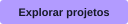</a>
  
  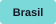


### 

**Olá, tudo bem?!** 

Sou o **Lucas (Luks) Alves**, desenvolvedor **Full Stack com foco em Front-End**. Crio aplicações web com **React e TypeScript**, integro serviços e também desenvolvo ferramentas locais em **Python**.

Gosto de juntar **programação, design e resolução de problemas** para transformar um *“será que dá pra fazer?”* em uma aplicação útil, com interfaces cuidadosas e atenção a quem usa.

**[Conheça meus projetos](#projetos) · [Entre em contato](#contato)**

  
  
  

 

### 

<table>
  <tr>
    <td width="30%" align="center" valign="middle">
      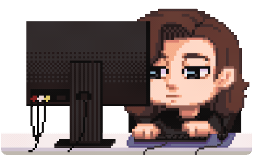
    </td>
    <td width="70%" valign="middle">
      
<strong>Feitos para resolver algo de verdade</strong>

      
Projetos que nasceram do trabalho e de necessidades do dia a dia.

      
Explore os cards abaixo para conhecer as interfaces, as decisões técnicas e, quando público, o código.

    </td>
  </tr>
</table>

<table>
  <tr>
    <td width="50%" valign="top">
      
      
<strong>IBN Acadêmico · React e Firebase</strong>

      
Sistema de gestão acadêmica em uso institucional. Atuei na modelagem dos dados, nas interfaces, na integração com Firebase e na publicação.

      
<a href="https://github.com/xLuuks/ibn-academico-portfolio" title="Apresentação e decisões técnicas do IBN Acadêmico">Ver apresentação</a> · Código-fonte institucional privado.

    </td>
    <td width="50%" valign="top">
      
      
<strong>Local Transcriber · Python e PySide6</strong>

      
Transcrição local de áudio e vídeo, com revisão por segmentos e exportação TXT/SRT. O processamento ocorre em segundo plano para manter a interface responsiva.

      
<a href="https://github.com/xLuuks/local-transcriber">Ver código e interface</a>

    </td>
  </tr>
  <tr>
    <td width="50%" valign="top">
      
      
<strong>SplitCraft · React e JavaScript</strong>

      
Criei para preparar imagens para redes sociais, com prévia dos recortes e processamento no navegador via Canvas API. Permite baixar as partes individualmente ou em ZIP.

      
<a href="https://splitcraft.pages.dev/">Experimentar</a> · <a href="https://github.com/xLuuks/splitcraft">Ver código</a>

    </td>
    <td width="50%" valign="top">
      
      
<strong>Local Scanner · React e TypeScript</strong>

      
Ajuste de documentos e geração de PDFs com processamento local no navegador.

      
<a href="https://github.com/xLuuks/local-scanner">Ver projeto</a>

    </td>
  </tr>
  <tr>
    <td width="50%" valign="top">
      
      
<strong>Mural de Oração · JavaScript e Firebase</strong>

      
Mural web para compartilhar pedidos de oração e registrar intercessões.

      
<a href="https://github.com/xLuuks/mural-de-oracao">Ver projeto</a>

    </td>
    <td width="50%" valign="top">
      
      
<strong>Alô Live · Python, Flask e PyQt5</strong>

      
Painel local para reunir comentários de duas transmissões do YouTube e enviar recados ao apresentador.

      
<a href="https://github.com/xLuuks/alo-live">Ver projeto</a>

    </td>
  </tr>
</table>

  **[Ver todos os meus repositórios](https://github.com/xLuuks?tab=repositories)**

### 

**Tecnologias e ferramentas**

  
 <strong>Front-End e interfaces</strong>

  
  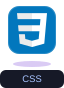
  
  
  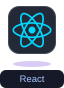
  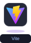
  
  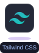

  
 <strong>Programação, dados e serviços</strong>

  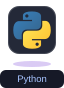
  
  

  
 <strong>Ferramentas e design</strong>

  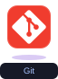
  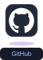
  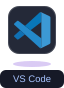
  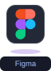

### 

**Duas paixões, um novo caminho**

**Animais e tecnologia sempre foram duas grandes paixões minhas.** Primeiro me formei em Medicina Veterinária; depois, segui a vontade de criar com tecnologia e me formei em Análise e Desenvolvimento de Sistemas. Hoje construo minha trajetória no desenvolvimento de software, levando comigo os aprendizados das duas áreas.

Também trabalho com **comunicação, design e audiovisual**, experiências que influenciam a forma como penso interfaces e soluções. Já fui streamer na Twitch e guardo dessa fase, principalmente, as amizades que fiz por lá.

 

 **Formação acadêmica**

<table>
  <tr>
    <td width="30%" align="center" valign="middle">
      
    </td>
    <td width="70%" align="left" valign="middle">
      
 <strong>Tecnologia em Análise e Desenvolvimento de Sistemas</strong> — Universidade Presbiteriana Mackenzie.

      
 <strong>Medicina Veterinária</strong> — Universidade Federal Rural de Pernambuco (UFRPE).

    </td>
  </tr>
</table>

### 

**O que quero aprofundar**

Quero aprofundar meus conhecimentos em **arquitetura, testes e manutenção de software**, conectando o estudo às decisões dos meus projetos: como organizar responsabilidades, proteger o trabalho de quem usa e facilitar a evolução de cada aplicação.

**Meu projeto atual é o site pessoal**, onde estou reunindo meu trabalho e minhas experiências.

 

### 

  

  <h3>Se uma ideia pode facilitar a vida de alguém, vale a pena tentar criar.</h3>

  
Vamos conversar sobre uma oportunidade ou um projeto?

  

    
    
    
  

   <strong>Personagem e ilustrações:</strong> <a href="https://www.instagram.com/elllerio/">Elle Rio (@elllerio)</a> — minha esposa e ilustradora. 

