<!-- PERFIL xLuuks | Lucas (Luks) Alves | versão tecnológica ilustrada -->

  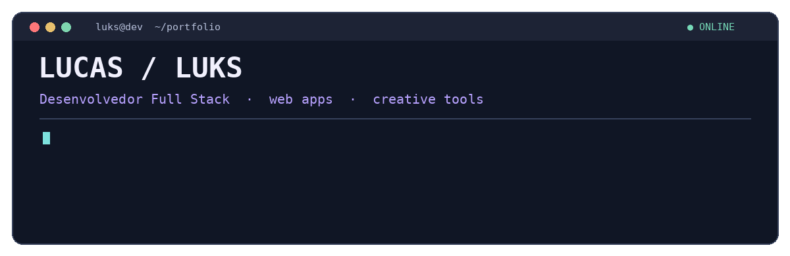

  
  
  

---

### `~/hello-world` · prazer, Lucas! 👋

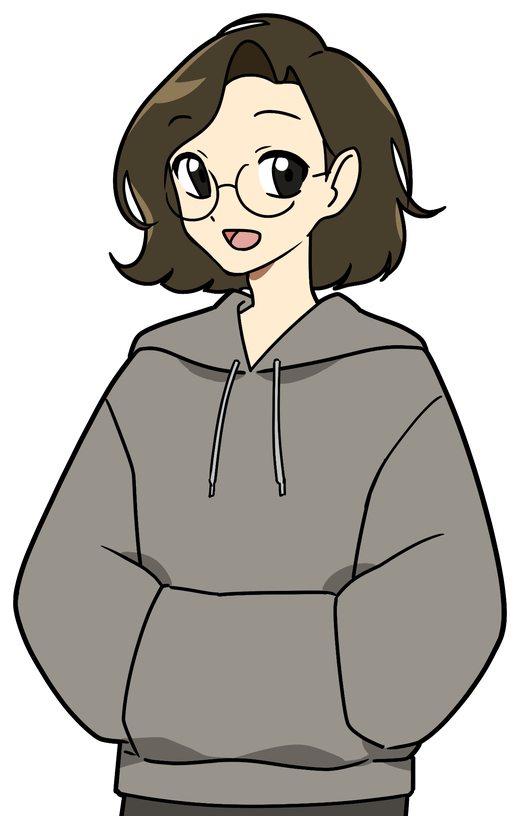

Sou o **Lucas (Luks) Alves**, desenvolvedor **Full Stack** e entusiasta de criar coisas úteis, especialmente aquelas que começam com um *“será que dá pra fazer?”* e terminam virando uma aplicação de verdade.

Gosto de juntar **programação, design e resolução de problemas** para construir ferramentas práticas, interfaces cuidadosas e experiências digitais que façam sentido para quem usa.

💻 **Foco:** Front-End, aplicações web e sistemas.  
🌱 **Interesse:** Engenharia de Software, arquitetura, qualidade e boas práticas.  
🎯 **Objetivo:** encontrar novas oportunidades como desenvolvedor.  
🧱 **Projeto atual:** estou desenvolvendo meu próprio site pessoal.

 

### `~/minha-trajetoria` · duas formações, muitas possibilidades

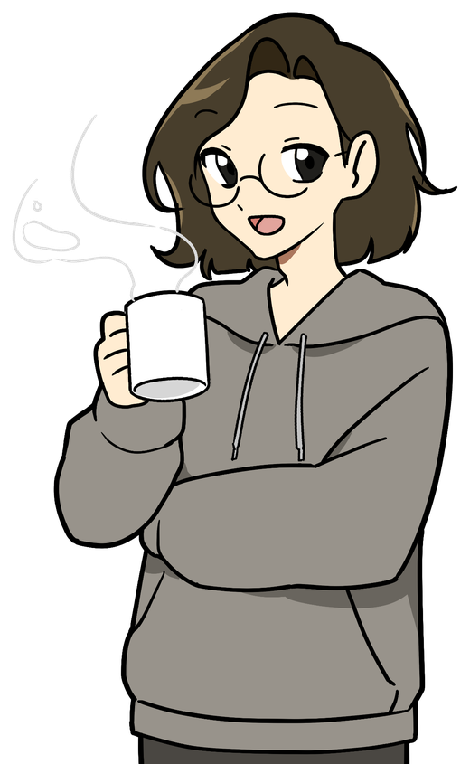

Sou formado em **Tecnologia em Análise e Desenvolvimento de Sistemas pela Universidade Presbiteriana Mackenzie** e em **Medicina Veterinária pela Universidade Federal Rural de Pernambuco (UFRPE)**.

Pode parecer uma mudança de rota inesperada (e talvez seja mesmo), mas gosto de explorar áreas diferentes. Hoje, além de desenvolver software, trabalho com **comunicação, design e audiovisual**, experiências que influenciam minha maneira de pensar em interfaces, fluxos e soluções para pessoas reais.

O que me motiva é simples: aprender, experimentar e transformar necessidades do dia a dia em projetos funcionais.

 

<table>
  <tr>
    <td width="75%" valign="middle">
      

<strong>🎓 Formação acadêmica</strong>

      
💻 <strong>Tecnologia em Análise e Desenvolvimento de Sistemas</strong> — Universidade Presbiteriana Mackenzie.

      
🐾 <strong>Medicina Veterinária</strong> — UFRPE.

      
🧠 <strong>Próximo campo de interesse:</strong> Engenharia de Software, com atenção especial a arquitetura, testes, manutenção e evolução de sistemas.

    </td>
    <td width="25%" align="center" valign="middle">
      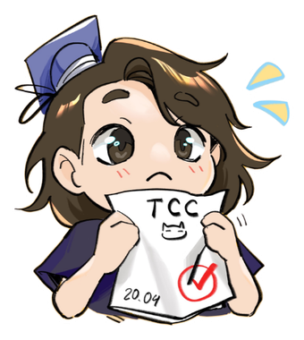
    </td>
  </tr>
</table>

---

### `~/stack` · tecnologias e ferramentas

  

  Front-end · sistemas web · ferramentas locais · integração de serviços · design de interfaces

---

### `~/projetos` · feitos para resolver algo de verdade

São projetos que nasceram do trabalho, de uma necessidade cotidiana ou da vontade de testar uma ideia. **Clique nos cards** para conhecer os detalhes, a interface e, quando público, o código.

<table>
<tr>
<td width="50%" valign="top"><a href="https://github.com/xLuuks/local-transcriber">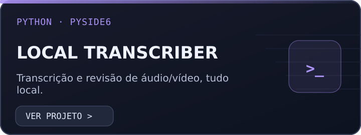</a></td>
<td width="50%" valign="top"><a href="https://github.com/xLuuks/splitcraft">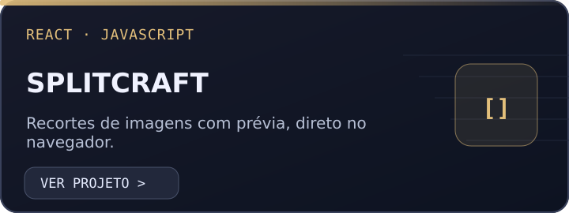</a></td>
</tr>
<tr>
<td width="50%" valign="top"><a href="https://github.com/xLuuks/mural-de-oracao">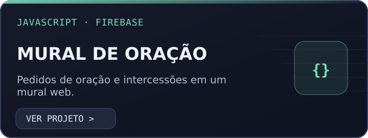</a></td>
<td width="50%" valign="top"><a href="https://github.com/xLuuks/local-scanner">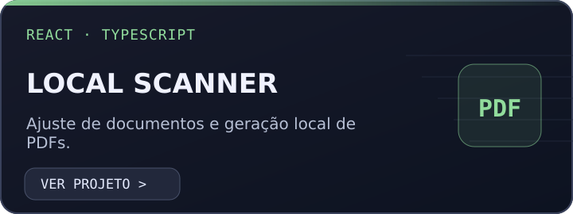</a></td>
</tr>
<tr>
<td width="50%" valign="top"><a href="https://github.com/xLuuks/ibn-academico-portfolio">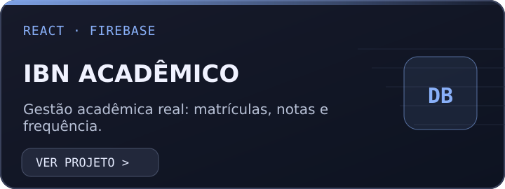</a></td>
<td width="50%" valign="top"><a href="https://github.com/xLuuks/alo-live">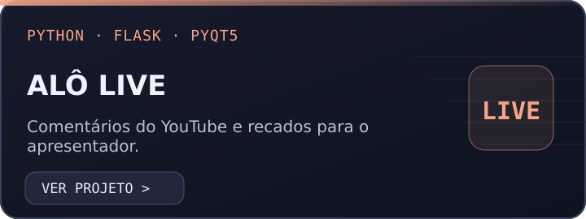</a></td>
</tr>
</table>

🔒 O IBN Acadêmico é apresentado como projeto de portfólio; o código-fonte institucional permanece privado.

  **[Ver todos os meus repositórios](https://github.com/xLuuks?tab=repositories)**

---

### `~/engenharia-de-software` · o que quero aprofundar

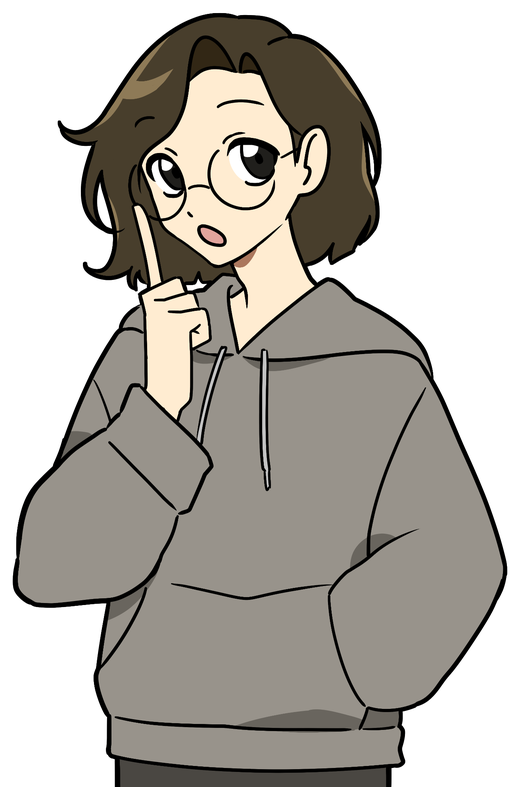

Meu interesse vai além de fazer uma interface funcionar. Quero entender **como planejar, estruturar, testar e evoluir software** de forma sustentável.

Tenho interesse especial em **Engenharia de Software**: organização de código, arquitetura, testes, documentação e decisões técnicas que tornam um projeto melhor ao longo do tempo.

No dia a dia, continuo aprendendo com projetos práticos — construindo, testando e melhorando uma versão de cada vez. **Atualmente, também estou desenvolvendo meu site pessoal**, que reúne meu trabalho e minhas experiências.

 

---

  

  <h3>Se uma ideia pode facilitar a vida de alguém, vale a pena tentar criar. ✨</h3>

  
Estou em busca de <strong>novas oportunidades como desenvolvedor</strong> e gosto de conhecer pessoas que também curtem transformar ideias em projetos.

---

  🎨 <strong>Personagem e ilustrações:</strong> <a href="https://www.instagram.com/elllerio/">Elle Rio (@elllerio)</a> — minha esposa e ilustradora. ❤️

